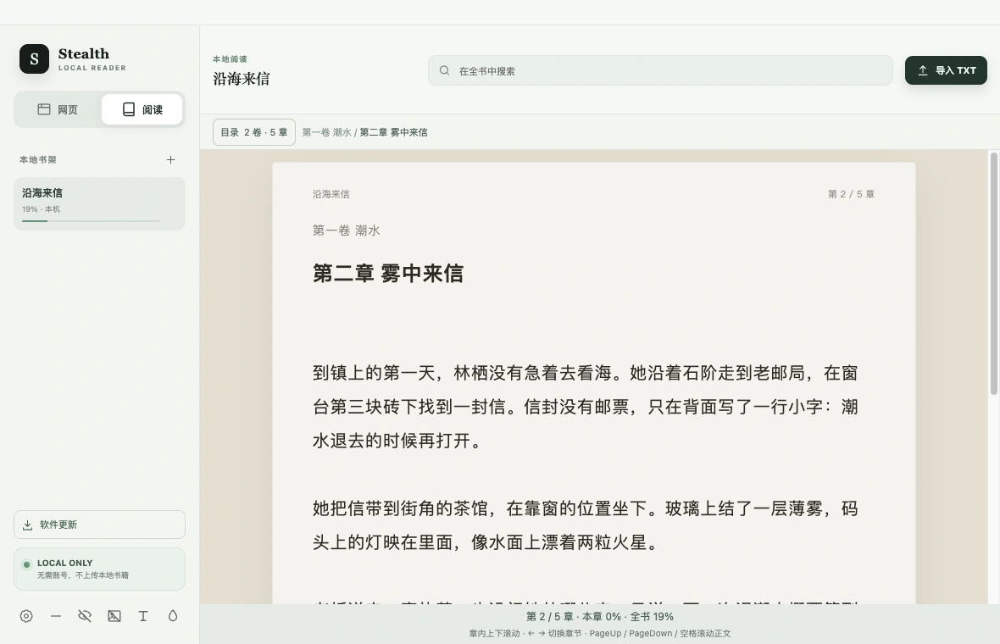
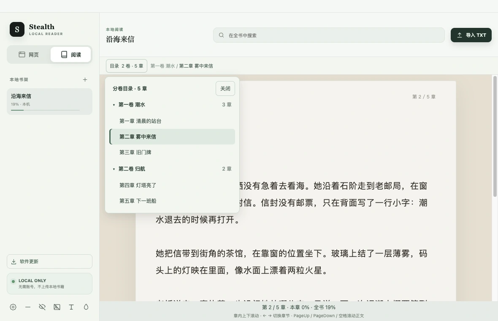
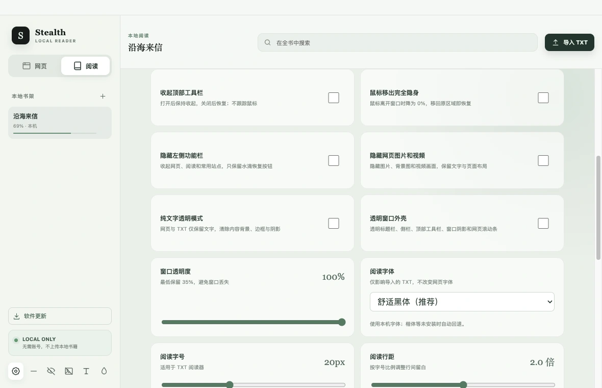

# Stealth Reader · Transparent Desktop TXT Reader

**A local-first TXT ebook reader and transparent web browser for macOS and Windows.** Import a plain-text book to browse its chapters, search the text, and resume where you left off. Use an always-on-top window, transparent text mode, or a global show/hide shortcut when you want a smaller reading space.

[简体中文](README.md) · [Download](https://github.com/bearqy/stealth-reader-desktop/releases/latest) · [Quick start](#quick-start) · [More screenshots](#more-screenshots)



*Actual macOS app screenshot with an original demo book. The screenshots show the current Chinese interface.*

## Download and install

Open the [latest GitHub Release](https://github.com/bearqy/stealth-reader-desktop/releases/latest) and choose the matching asset:

| Platform | Filename suffix |
| --- | --- |
| Mac · Apple Silicon | `-macos-arm64.dmg` |
| Mac · Intel | `-macos-x64.dmg` |
| Windows · x64 installer | `-windows-x64-setup.exe` |
| Windows · x64 portable | `-windows-x64-portable.exe` |

Choose the standard `StealthReader-<version>-<platform>` filename. Files beginning with `Stealth-Reader-` are compatibility copies for older updaters. On Mac, open the DMG and drag the app to Applications. On Windows, run the installer or open the portable executable.

Mac builds are ad-hoc signed and not Apple-notarized. Windows builds are not commercially code-signed. Download from this repository's Releases and compare the file with `SHA256SUMS.txt` if needed. See [macOS signing](docs/MACOS_SIGNING.md) and [updates](docs/UPDATES.md) for details.

## Quick start

1. **Read a local book.** Choose **阅读 → 导入 TXT** (Read → Import TXT). Open the table of contents to jump to a chapter. Scroll within a chapter; use the centered buttons at the end to change chapters. The left/right arrow keys also work when the reading area is focused.
2. **Keep the reader on top.** In Settings (设置), enable always on top and adjust opacity or switch on transparent text mode. The default global show/hide shortcut is `Cmd+Shift+H` on Mac or `Ctrl+Shift+H` on Windows.
3. **Browse the web.** Switch to **网页** (Web) and open a site in a tab. Web images and videos can be hidden when you prefer a text-focused view.

## Features

- **Offline TXT reading:** UTF-8, UTF-16, and GB18030 imports up to 32 MB per file; chapter and volume detection for common Chinese and English headings; full-text search and saved reading progress.
- **Reading typography:** adjustable font, size, line height, letter spacing, and theme, with a live preview.
- **Transparent browser and reader:** supported backgrounds, borders, and shadows can be removed to reveal the app beneath. Transparency does not make the window click-through. The toolbar and sidebar can be collapsed, and the window can hide when the pointer leaves.
- **Background update checks:** the app checks after startup and roughly every six hours after a successful check. Offline errors are retried quietly. Downloads and installation are always initiated by the user. On Mac, v0.1.6 and later can restart to install a downloaded update.
- **Local-first:** no account needed. Imported books, bookshelf data, and reading progress are not uploaded. EPUB, PDF, cloud sync, and a built-in online novel catalog are not supported at present; web browsing still connects to the original sites.

## More screenshots

<details>
<summary>Chapter directory, chapter navigation, and transparency settings</summary>






</details>

## Development and feedback

The app uses Electron, TypeScript, React, Vite, and Vitest. Use Node.js 24:

```bash
npm ci
npm run dev
```

Checks and build: `npm test`, `npm run test:reader`, `npm run build`.

- [TXT reading](docs/TXT_READING.md) · [Updates](docs/UPDATES.md) · [Security and privacy](docs/SECURITY_PRIVACY.md) (Chinese)
- [Project status](docs/MVP_STATUS.md) · [Architecture](docs/ARCHITECTURE.md) · [Development](docs/DEVELOPMENT.md) · [Roadmap](docs/ROADMAP.md) (Chinese)
- Report problems or suggest improvements through [GitHub Issues](https://github.com/bearqy/stealth-reader-desktop/issues). Include your app version and OS. For chapter detection problems, share a small, non-sensitive sample of the headings rather than the full book.
