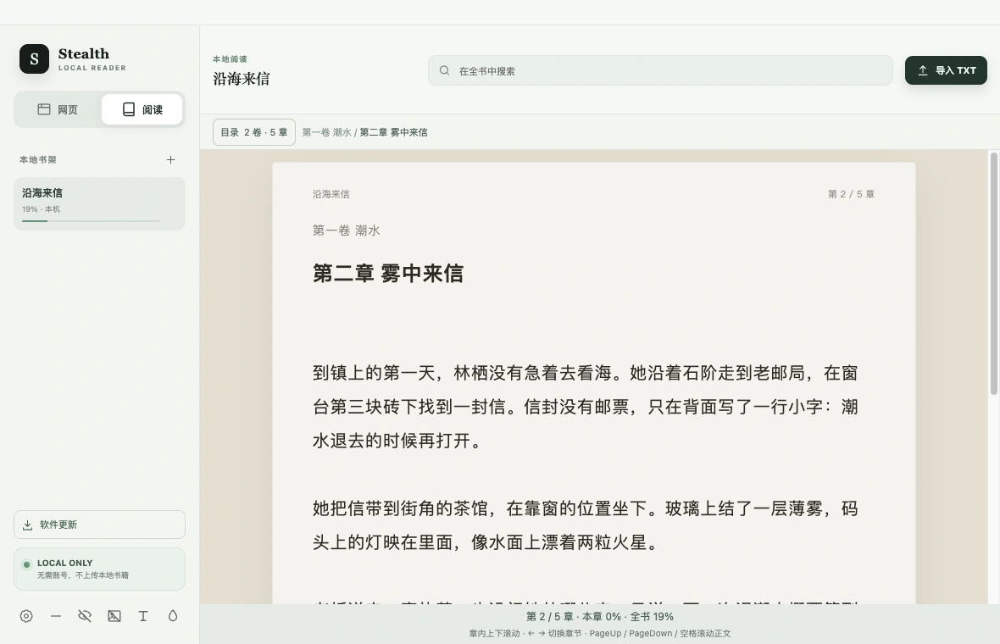
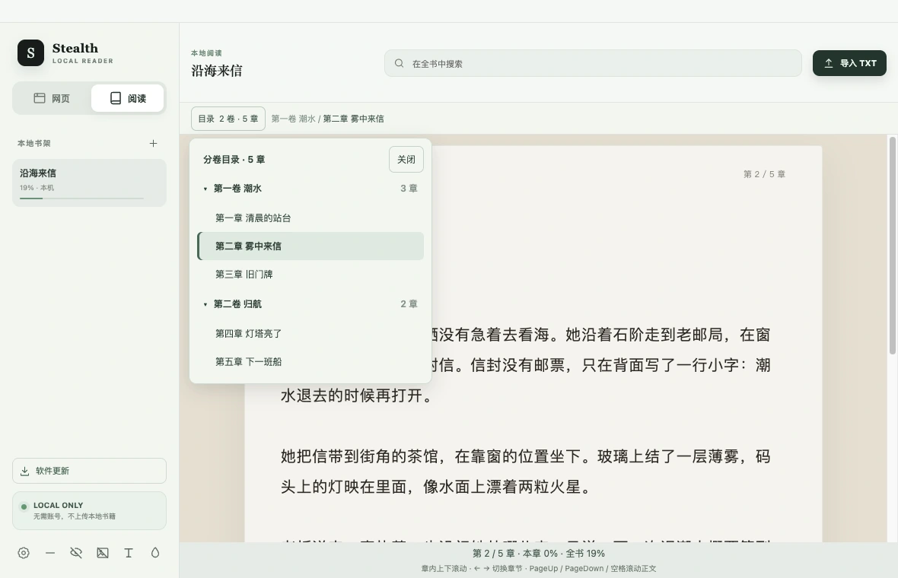
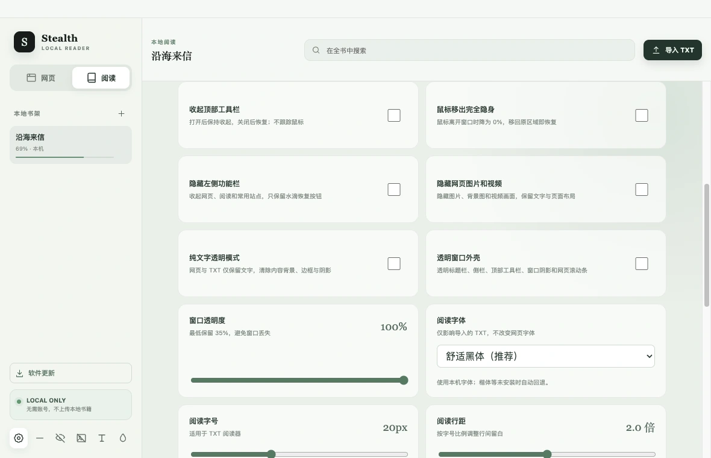

# Stealth Reader · 桌面透明 TXT 阅读器

**一款适用于 macOS 和 Windows 的本地 TXT 阅读器，也能用透明窗口浏览网页。** 导入小说 TXT 就能分卷分章、查目录、接着读；想把文字留在屏幕一角时，可以开启窗口置顶、纯文字透明模式，或用快捷键快速显示和隐藏。

[下载最新版](https://github.com/bearqy/stealth-reader-desktop/releases/latest) · [快速上手](#快速上手) · [更多截图](#更多截图) · [English](README.en.md)



*macOS 实际运行截图，书籍为原创演示文本。*

Stealth Reader is a local-first desktop TXT ebook reader and transparent web browser for macOS and Windows, with automatic chapter detection, offline reading, and an always-on-top window.

## 下载与安装

前往 [GitHub Releases 最新版](https://github.com/bearqy/stealth-reader-desktop/releases/latest)，在 **Assets** 中选择：

| 系统 | 安装包后缀 |
| --- | --- |
| Mac · Apple Silicon（M 系列） | `-macos-arm64.dmg` |
| Mac · Intel | `-macos-x64.dmg` |
| Windows · 64 位安装版 | `-windows-x64-setup.exe` |
| Windows · 64 位免安装版 | `-windows-x64-portable.exe` |

优先选择 `StealthReader-版本号-平台` 开头的文件；带连字符的 `Stealth-Reader-*` 是旧更新器的兼容副本。Mac 打开 DMG 后将应用拖入「应用程序」，Windows 运行安装包或直接打开免安装版。

Mac 安装包使用 ad-hoc 签名，未做 Apple 公证；Windows 尚未做商业代码签名。首次打开遇到系统提示时，先确认安装包来自本仓库的 Releases，可用同页的 `SHA256SUMS.txt` 核对。详见 [macOS 签名说明](docs/MACOS_SIGNING.md) 和 [版本更新说明](docs/UPDATES.md)。

## 快速上手

1. **读本地小说**：点「阅读 → 导入 TXT」，选择文件即可。目录能定位当前章；一章内上下滚动，章末有「上一章 / 下一章」。焦点在正文时，也可用左右方向键切章。
2. **把阅读放到屏幕一角**：到「设置」开启窗口置顶，再调整透明度或开启「纯文字透明模式」。默认全局快捷键为 Mac 的 `⌘⇧H`、Windows 的 `Ctrl+Shift+H`，用于显示或隐藏窗口。
3. **打开网页**：切换到「网页」，输入地址或使用多标签浏览。可以隐藏网页图片与视频，也可以保留原本的网页显示。

## 主要功能

- **TXT 书架与章节目录**：支持 UTF-8、UTF-16 和 GB18030，单文件最大 32 MB。自动识别常见中文和英文章节标题（章、节、卷、Chapter 等），无标题时按段落分段。支持全文搜索、进度保存和离线续读。
- **排版可调**：黑体、宋体、楷体可选，支持字号、行距、字距、主题切换和实时预览。
- **透明阅读与窗口控制**：纯文字模式会移除支持区域的背景、边框和阴影，让下层应用透出来；透明不等于鼠标点透。也可收起工具栏和侧栏、设置鼠标移出时隐藏，通过系统托盘恢复窗口。
- **后台检查版本**：启动后延迟检查，成功后约每 6 小时检查一次；断网时静默重试。是否下载或安装由你决定。Mac v0.1.6 及更新版本可下载后选择「重启并安装更新」。
- **本地优先**：无需注册，不上传 TXT、书架或阅读进度。当前不支持 EPUB / PDF、云同步或内置在线小说全文库；网页功能仍需连接原站。

## 更多截图

<details>
<summary>分卷目录、章末切换与透明设置</summary>

**目录自动定位当前章节**



**正文末尾居中的切章按钮**


**窗口透明度和纯文字设置**



</details>

## 开发与反馈

技术栈：Electron、TypeScript、React、Vite、Vitest。使用 Node.js 24：

```bash
npm ci
npm run dev
```

验证与构建：`npm test`、`npm run test:reader`、`npm run build`。

- [TXT 分卷与章节阅读](docs/TXT_READING.md) · [在线更新](docs/UPDATES.md) · [安全与隐私](docs/SECURITY_PRIVACY.md)
- [项目现状](docs/MVP_STATUS.md) · [技术架构](docs/ARCHITECTURE.md) · [开发规范](docs/DEVELOPMENT.md) · [路线图](docs/ROADMAP.md)
- 有问题或需求？可以在 [GitHub Issues](https://github.com/bearqy/stealth-reader-desktop/issues) 反馈。请注明应用版本和系统；如遇分章问题，提供少量可公开的章节标题示例即可，无需上传整本书。
