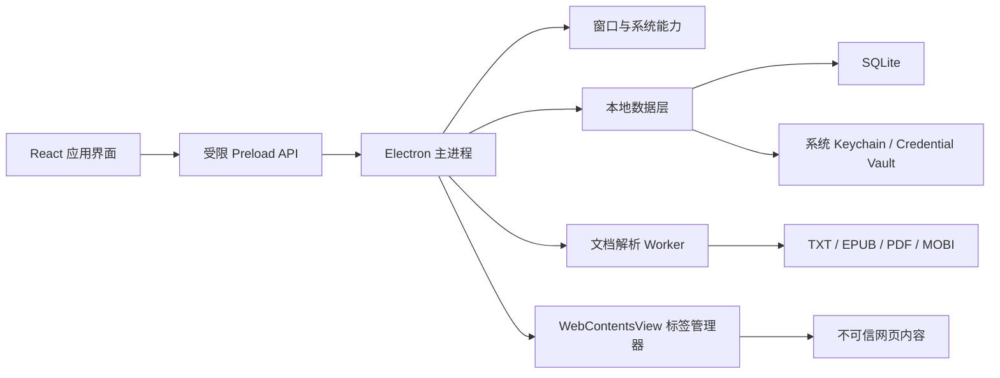

# 技术架构

## 1. 架构目标

- 使用一套主要代码支持 macOS 与 Windows。
- 将桌面系统权限、应用界面和不可信网页严格隔离。
- 本地文档解析不阻塞主进程和渲染进程。
- 允许逐步增加账号或同步服务，但第一阶段不依赖后端。

## 2. 总体结构



## 3. 进程边界

### 3.1 主进程

负责：

- 窗口生命周期、置顶、透明度和显示状态。
- 全局快捷键、托盘、系统菜单和自动更新。
- 标签 WebContentsView 的创建、销毁和权限策略。
- 文件选择、下载和安全的本地数据访问。
- 受控 IPC 路由。

主进程不负责渲染大文本，不执行来自网页的脚本请求。

### 3.2 应用渲染进程

负责：

- 地址栏、标签栏、书架、阅读器和设置界面。
- 只通过声明式、白名单化的 preload API 调用桌面能力。
- 不直接访问 Node.js、文件系统或 Electron 主进程对象。

要求：

- `contextIsolation: true`
- `nodeIntegration: false`
- `sandbox: true`
- 严格 Content Security Policy

### 3.3 网页标签进程

每个网页标签使用独立的 WebContentsView。网页内容是完全不可信输入：

- 不注入 Node.js。
- 不暴露应用 preload API。
- 禁止危险协议和任意本地文件访问。
- 权限请求由主进程统一判断。
- 新窗口、下载和外部协议必须经过明确策略。
- 标签崩溃单独恢复。

### 3.4 文档解析 Worker

TXT 编码检测、EPUB 解包、PDF 索引和全文搜索在独立 worker 或 utility process 中执行。解析器输出标准化文档模型，不直接操作窗口。

## 4. 推荐目录结构

```text
apps/
  desktop/
    src/
      main/
      preload/
      renderer/
      workers/
packages/
  browser-core/
  reader-core/
  shared-types/
  ui/
  config/
docs/
  decisions/
tests/
  e2e/
  fixtures/
```

进入开发阶段后再创建代码目录；当前仓库仅包含设计文档。

## 5. 模块划分

### 5.1 Window Manager

- 主窗口与迷你模式状态机。
- 窗口位置、尺寸和显示器变化恢复。
- 透明度安全下限。
- 置顶级别和全屏应用兼容策略。
- 自动隐藏计时与防抖。

### 5.2 Shortcut Manager

- 全局快捷键注册与释放。
- 冲突检测。
- macOS 与 Windows 键位归一化。
- 安全恢复快捷键，防止窗口永久不可见。

### 5.3 Tab Manager

- 标签生命周期和会话恢复。
- 每站点缩放、UA 和配置。
- 崩溃隔离。
- 导航策略、弹窗策略和下载策略。

### 5.4 Reader Core

统一文档接口：

```ts
interface ReaderDocument {
  metadata: DocumentMetadata
  navigation: NavigationTree
  openPosition(position: ReadingPosition): Promise<RenderedSection>
  search(query: string, signal: AbortSignal): AsyncIterable<SearchResult>
}
```

不同文件格式通过适配器实现，UI 不直接依赖具体解析库。

### 5.5 Persistence

建议使用 SQLite 保存结构化数据：

- settings
- bookmarks
- browsing_history
- sessions
- library_items
- reading_progress
- schema_migrations

站点 Cookie、缓存和证书状态交给 Electron/Chromium session 管理。敏感令牌仅存放在操作系统安全存储中。

## 6. IPC 规范

- 通道名集中定义，不允许自由字符串。
- 请求与响应使用共享 TypeScript 类型。
- 所有主进程入口做运行时 schema 校验。
- API 按能力拆分，例如 `window.setOpacity`、`library.openFile`。
- 禁止提供通用 `exec`、任意文件读取或任意 IPC 转发能力。

## 7. 跨平台策略

统一核心逻辑，系统差异封装在 platform adapter：

```text
platform/
  macos/
  windows/
  shared/
```

需要单独验证的功能：

- macOS 辅助功能或自动化权限提示。
- macOS 全屏空间中的置顶行为。
- Windows 任务栏、托盘和防截屏行为。
- Apple Silicon 与 Intel 原生构建。

## 8. 构建与发布

- 使用签名锁定的 Node.js 和包管理器版本。
- 依赖必须通过 lockfile 固定。
- macOS 构建分别生成 arm64 与 x64，可选 universal 包。
- Windows 生成签名安装包和可选便携包。
- 正式发布需要代码签名、公证、更新清单签名和可回滚版本。

## 9. 可观测性

默认只记录应用自身的技术日志：

- 启动、升级、迁移和崩溃摘要。
- 不记录完整 URL 查询参数、网页正文、书籍正文和键盘输入。
- 日志支持用户主动导出。
- 遥测如未来加入，必须明确选择加入并提供关闭入口。
